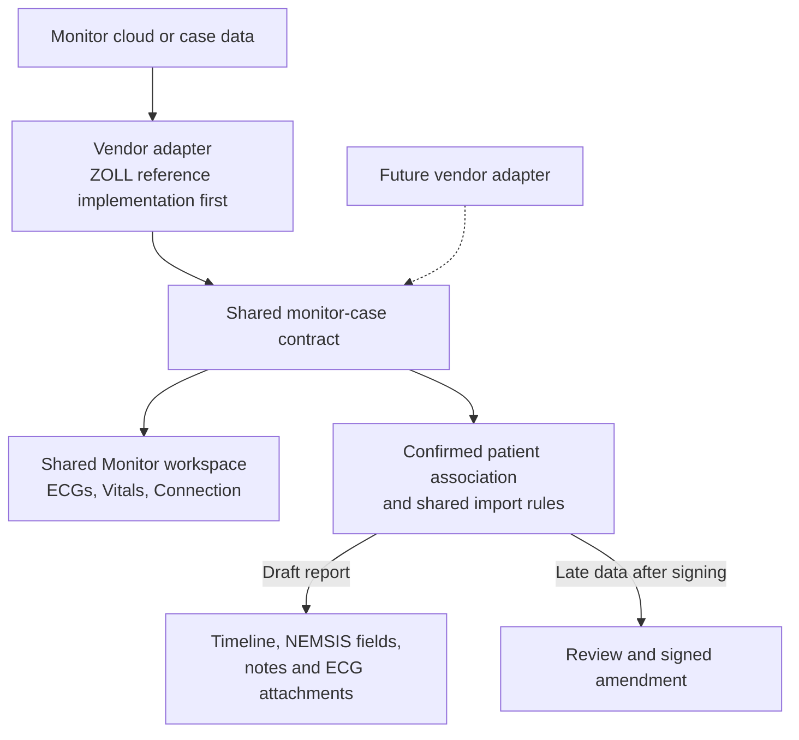

# Monitor Integration PRD

# Problem Statement

Clinicians need discrete monitor observations and ECGs in OpenTriage while
patient care is still underway. Manually transcribing vitals and treatment
button events duplicates work and separates the record from its source.
Completing a case before transferring it would miss the intended during-care
workflow. Clinicians also need to inspect newly acquired ECGs without leaving
the patient report or depending on a live waveform viewer.

OpenTriage already has canonical NEMSIS entries, mobile quick actions, a shared
timeline, report notes, signing, and Review. It does not yet have the monitor
case association, acquisition, source reconciliation, ECG artifact handling,
or focused Monitor workspace required for this workflow. Its existing dispatch
ingestion provides useful patterns, but dispatch complete-snapshot retraction
semantics do not fit selected or overlapping monitor imports.

Monitor vendors differ in how they expose cases, observations, and ECGs. The
patient association, charting, correction, and review workflow needs to remain
consistent across those sources. OpenTriage needs a shared integration contract
and clinical lifecycle that each supported vendor adapter can exercise.

Ambulances in Uppsala do not have Wi-Fi. The integration must therefore assess
a cloud route and, once the SDK is available, Bluetooth. Online-only operation
is acceptable. A cloud connector should serve both Mobile and Stationary, but
the monitor's own internet uplink and the availability of data from an active
case remain dependencies to prove.

# Solution

Build a shared monitor integration that connects device data to OpenTriage's
existing clinical workflow: discover a case, confirm the patient association,
receive observations and ECGs during care, and maintain their provenance through
charting, correction, signing, and review. Mobile and Stationary use the same
Monitor workspace behavior and clinical rules for every supported adapter.

Vendor adapters handle acquisition, source decoding, and capability reporting
behind a common monitor-case contract. Prefer pushed updates when the vendor
interface supports them; retain active fetching and a clinician-facing Fetch
latest action as fallbacks. Run cloud acquisition independently of an open
browser.

ZOLL X Series is the first adapter and the reference implementation used to
prove the shared contract and complete workflow. Its SDK and physical-device
validation provide the first compatibility evidence. Subsequent adapters should
reuse the ingestion, UI, and review behavior; implementing another vendor is
outside this release.

After a clinician explicitly links a monitor case and confirms its import time
range, automatically add eligible discrete readings and mapped treatment
events to the ordinary patient record. Completed BP cycles, including scheduled
cycles, import their associated vital-sign set without filling missing values
from older readings. Mapped treatment buttons create normal medication or
procedure entries with missing details left for normal completion. Unmapped
button labels become native text notes. Continuous numeric readings can be
viewed during care but do not automatically become formal chart entries.

Provide a persistent Monitor button in Mobile and Stationary. It opens a side
panel on Stationary and a full-width view on Mobile, with ECGs, Vitals, and
Connection tabs. Retain discrete 12-lead reports automatically; allow clinicians
to choose other captured rhythm strips. Display one ECG acquisition at a time
with basic viewing controls. Imported chart entries remain editable through
the existing quick-action and note interfaces, with monitor provenance visible.

Normal acquisition-to-availability delay must be no more than five seconds.
Sixty seconds is the outer failure threshold, not an acceptable normal delay.
Show connection issues as non-blocking checklist warnings and preserve report
signing. Late eligible data is retained for a built-in Unreviewed monitor data
criterion, with accepted additions incorporated only through signed amendments.

The flow below separates vendor acquisition from shared product behavior. The
dashed branch shows where a future adapter joins the same contract. Case
linkage and import scope are confirmed through Monitor; eligible discrete
data then follows the automatic acceptance rules. Continuous readings remain
available for viewing without automatically entering the chart.

# User Stories

1. As a clinician, I want monitor vitals and ECGs available during an active case, so that I can document and inspect them during patient care.
2. As a clinician, I want normally acquired data available within five seconds, so that the monitor view is useful while care is underway.
3. As a clinician, I want severe delivery delays clearly identified, so that old data is not mistaken for a current observation.
4. As a clinician, I want supported pushed updates to arrive automatically, so that I do not need to repeatedly request new data.
5. As a clinician, I want Fetch latest when automatic delivery is unavailable or needs recovery, so that I can explicitly request an update.
6. As a clinician, I want linked cloud acquisition to continue when I navigate away or close the browser, so that documentation does not depend on keeping a screen open.
7. As a Mobile or Stationary clinician, I want access to the same cloud-delivered case data, so that my choice of interface does not change the available information.
8. As a clinician, I want to explicitly confirm the monitor case associated with my patient, so that automatic imports have a deliberate patient association.
9. As a clinician, I want recent cases filterable by monitor and time, so that I can find the intended case quickly.
10. As a clinician, I want monitor name, serial number, case start time, and latest activity shown during selection, so that similar cases can be distinguished.
11. As a clinician, I want a case preview and an explicit Link case action, so that selection alone does not begin importing into a patient record.
12. As a clinician, I want to confirm or narrow the case's import time range, so that earlier relevant care is included and unrelated data is excluded.
13. As a clinician, I want eligible observations and 12-leads already recorded within that range imported when I link a case, so that opening OpenTriage later does not lose earlier care.
14. As a clinician, I want several monitor cases linked to one report, so that changing monitors during care does not fragment the patient record.
15. As a clinician, I want an already-associated case unavailable for ordinary linking to another report, so that the same source case is not accidentally assigned to two patients.
16. As a clinician, I want explicitly initiated discrete readings accepted automatically after linking, so that I do not have to approve every routine observation again.
17. As a clinician, I want scheduled BP cycles treated like individually initiated BP measurements, so that scheduled measurements are captured consistently.
18. As a clinician, I want the available heart rate, SpO2, respiratory rate, ETCO2, and other supported observations associated with a BP cycle imported together, so that the recorded set reflects the source event.
19. As a clinician, I want each observation's measurement time preserved and missing parameters left empty, so that a set does not imply simultaneous or available readings that were never supplied.
20. As a clinician, I want device-invalid or failed measurements visible for review without becoming automatically accepted chart values, so that acquisition failures are not represented as observations.
21. As a clinician, I want continuous numeric readings available during active care without automatically filling the formal record, so that high-frequency data does not overwhelm documentation.
22. As a clinician, I want imported vitals shown in the ordinary timeline and corresponding NEMSIS fields, so that there is one charting workflow.
23. As a clinician, I want mapped treatment-button events to create ordinary medication or procedure entries, so that monitor documentation appears alongside manually entered care.
24. As a clinician, I want missing details from mapped treatment events flagged in the checklist, so that I can complete them through the usual editor.
25. As a clinician, I want a treatment label to populate only the facts it supplies, so that dose, route, success, or other details are not invented.
26. As a clinician, I want an unmapped monitor-button event recorded as a text note with its original label and event time, so that the event is retained without requiring classification.
27. As a clinician, I want a compact Monitor source label on imported timeline entries, so that I can distinguish their origin without changing how I use the timeline.
28. As a clinician, I want detailed monitor, case, and timestamp provenance available when I open an entry, so that I can investigate its source.
29. As a clinician, I want edits and exclusions to survive repeated imports, so that a later fetch cannot undo my decisions.
30. As a clinician, I want source changes that conflict with my decisions surfaced for review, so that neither version silently replaces the other.
31. As a clinician, I want Stop importing to end acquisition from a link while preserving its chart entries, so that stopping a connection does not remove documentation.
32. As a clinician, I want Remove imported data to preview affected entries before removing them from a draft and stopping that link, so that a wrong association can be corrected deliberately.
33. As an auditor, I want removal to account for clinician-edited derivatives and preserve history, so that correcting an association does not conceal its effects.
34. As a clinician, I want to preview and apply a clock-offset correction to a linked case, so that an incorrectly set monitor clock does not require editing every timestamp separately.
35. As an auditor, I want original device times and clock-correction history retained, so that corrected chronology remains traceable.
36. As a clinician, I want a persistent Monitor button in both interfaces, so that linkage and ECGs are accessible throughout charting.
37. As a clinician, I want Monitor status colors to follow report save-status conventions and include a readable label, so that connection state is familiar and does not depend on color alone.
38. As a clinician, I want a small new-event badge on Monitor, so that I notice discrete arrivals without an interruption.
39. As a clinician, I want that badge to count events rather than individual parameters or streaming samples, so that the count is meaningful.
40. As a clinician, I want opening Monitor to clear my new-event count, so that the badge reflects arrivals since my last visit.
41. As a clinician, I want my seen state synchronized across Mobile and Stationary without clearing a colleague's count, so that awareness is personal to each user.
42. As a Stationary clinician, I want Monitor beside the report, so that I can consult it while charting.
43. As a Mobile clinician, I want Monitor to use the available screen width, so that its controls and ECGs remain usable.
44. As a clinician, I want opening and closing Monitor to preserve report position and unsaved edits, so that consulting device data does not interrupt documentation.
45. As a clinician, I want ECGs, Vitals, and Connection separated into tabs, so that each task has a focused workspace.
46. As a clinician, I want Monitor to open on ECGs when a case is linked and case selection when none is linked, so that the initial view matches the next useful action.
47. As a clinician, I want the selected Monitor tab remembered for the report, so that repeated visits preserve context.
48. As a clinician, I want discrete 12-lead reports retained automatically, so that each acquisition remains available with the patient record.
49. As a clinician, I want to select other captured rhythm strips for retention, so that routine strips do not overwhelm the report.
50. As a clinician, I want one original ECG acquisition displayed with pan, zoom, fit-to-width, and full-screen controls, so that I can inspect it on either interface.
51. As a clinician, I want ECG time, source, and calibration markings preserved, so that viewing does not discard information supplied by the monitor.
52. As a clinician, I want a new ECG to update the list and offer New ECG available without switching the current viewer, so that my inspection and zoom are not interrupted.
53. As a clinician, I want the Vitals tab to show one selected case with a clear monitor and case selector, so that readings from different devices are not silently combined.
54. As a clinician, I want Vitals initially focused on the most recently linked active case, so that the current source is readily available.
55. As a clinician, I want accepted entries from all linked cases combined in the report timeline, so that the chronology remains complete.
56. As a clinician, I want the browser's remembered monitor to filter recent cases by default, so that the usual device is quick to find.
57. As a clinician, I want to temporarily override that filter without changing persistent defaults, so that using another monitor does not require administrative setup.
58. As an administrator, I want separate browser cookies for the selected unit and monitor, so that each preference can be managed independently.
59. As an administrator, I want authority to establish or change those persistent selections and re-link them after a cookie wipe, so that browser setup has an accountable owner.
60. As a clinician, I want patient-case linking available without administrative privileges, so that ordinary clinical work does not depend on an administrator.
61. As a clinician, I want connection issues and the last successful sync visible in the checklist, so that missing data is apparent before signing.
62. As a clinician, I want a monitor connection warning to be non-blocking, so that a transport outage does not prevent report completion.
63. As a reviewer, I want late eligible data to create a built-in Unreviewed monitor data item, so that follow-up does not require an administrator-authored rule.
64. As a reviewer, I want late arrivals grouped into one durable report-criterion item, so that retries and multiple observations do not create duplicate review work.
65. As a reviewer, I want genuinely new unresolved arrivals to reopen a completed item, so that later evidence is not hidden by an earlier conclusion.
66. As an authorized clinician, I want accepted late observations, notes, or ECGs incorporated through a signed amendment, so that the signed report remains immutable.
67. As an authorized reviewer, I want to exclude late data with a recorded reason, so that irrelevant or incorrect data can be addressed without adding it to the record.
68. As a reviewer, I want the item to clear only when all pending data has been addressed, so that a partial decision cannot conceal outstanding work.
69. As an integration maintainer, I want synthetic examples and expected results for the shared monitor behavior, so that another vendor adapter can demonstrate compatibility.
70. As an integration operator, I want SDK-based development separated from physical-device validation, so that unverified hardware behavior is not presented as delivered capability.
71. As an integration operator, I want the tested model, firmware, SDK version, transport, and measured latency recorded, so that the supported configuration is explicit.
72. As an authorized user, I want monitor cases, artifacts, and review evidence governed by the patient's and agency's access boundaries, so that integration does not expose another patient's or agency's information.

# Implementation Decisions

## Shared architecture and adapter boundary

The common contract is the boundary between vendor-specific communication and
OpenTriage's clinical behavior. Adapters translate source cases, observations,
quality indicators, treatment markers, and ECG references into this contract.
Shared services own patient association, acceptance rules, canonical projection,
clinician corrections, artifact retention, and late-data review.

Expose supported capabilities and unavailable data explicitly. The workspace
uses that information without assuming every monitor has the same measurements,
ECG formats, or transport. Vendor/model identity remains visible as provenance;
it does not select a different clinical workflow or weaken validation.

Use the reference adapter to validate this boundary against a real SDK and
device. Keep shared fixtures and behavioral tests independent of its payload
format so the same expectations can be applied to a later adapter.

The five modules below were presented and approved together with testing of
all five. Keep substantial behavior behind small, independently testable
interfaces. Extend existing report, note, signing, and Review services where
they own the behavior; do not create parallel clinical records or a generic
plugin framework as part of this work.

| Module | Responsibility | Interface boundary |
| --- | --- | --- |
| Vendor acquisition adapter | Supported SDK/API acquisition, case discovery, source decoding, push subscription when available, fetch fallback, connection health, and representative fixtures; ZOLL supplies the first implementation | Discover cases, receive/fetch case data, expose capabilities and acquisition status; emit versioned vendor-neutral source events and artifacts |
| Shared monitor ingestion | Case-to-report association, import scope, classification and mapping, idempotency, provenance, automatic draft imports, source corrections, clinician ownership, and clock corrections | Validate source deliveries; link or stop a case; preview/apply import and removal; return accepted, duplicate, pending, excluded, or conflicting outcomes |
| ECG artifacts | Preserve and authorize retrieval of original ECG reports/strips, retention choices, integrity, and report/amendment attachment lifecycle | List acquisitions, open protected content, retain an eligible artifact, and expose acquisition metadata and readiness |
| Clinical follow-up | Checklist connection warnings, late-data evidence, built-in criterion lifecycle, and focused signed-amendment acceptance | Expose connection findings, collect pending evidence, apply authorized dispositions, and reconcile one review item per report |
| Monitor workspace and setup | Responsive tabs and viewer, timeline/editor integration, clinical updates, personal seen state, and administrator-managed browser defaults | Consume a shared authorized monitor view, issue clinical/setup commands, and acknowledge the clinician's new-event count |

The shared interfaces define observable product behavior. Vendor endpoint
names, SDK calls, and runtime bridges are established when implementing each
adapter. The physical storage design must serve the shared clinical lifecycle
without depending on one vendor's wire format.

## Reference implementation and delivery phases

The first delivery proves the shared integration with ZOLL X Series. Both
phases cover the whole workflow, including canonical chart entries, ECG
artifacts, the Monitor workspace, and Review. Vendor-specific access and
hardware constraints below apply to this reference implementation; the shared
product requirements apply to any subsequent adapter.

### Phase 1: shared integration and reference adapter

- Begin when the supported SDK and its documentation are available. Target
  the X Series family; do not silently narrow the requirement to X Series
  Advanced or promise every X Series firmware version.
- First determine whether eligible discrete observations and ECG reports can
  be obtained before the case closes, and whether supported push is available.
  Active-case access is a requirement of the intended release.
- Use push as the primary mechanism whenever the SDK provides a viable
  supported interface. Active fetching is the fallback, not the preferred
  baseline. Keep Fetch latest as an explicit refresh/recovery action through
  the same ingestion behavior.
- Investigate cloud transport first. Assess Bluetooth feasibility only once
  the SDK is available; browser/native platform and deployment decisions for
  Bluetooth are deferred. An ambulance Wi-Fi or LAN connector is not a
  deployment assumption.
- Implement the approved modules, shared contracts, synthetic fixtures, and
  automated tests using SDK samples or a supported simulator. Exercise the
  actual supported decoder when available; distinguish decoded test fixtures
  from evidence that the real transport works.
- Record unsupported or unproven capabilities, including active-case ECG
  availability and latency. Samples or a simulator alone do not establish
  physical-device compatibility.
- If active-case access is unavailable, record a feasibility blocker. Do not
  relabel completed-case import as satisfying the agreed first release.

### Phase 2: end-to-end validation with a physical monitor

- Validate the reference adapter with a physical X Series. Record the model,
  firmware, SDK version, enabled services, transport, and actual
  monitor-to-cloud uplink.
- Validate active-case observations, manually initiated and scheduled BP sets,
  treatment buttons, ECG availability and visual fidelity, case identities,
  time handling, duplicates, reconnects, and background import.
- Measure acquisition-to-availability latency through the whole path,
  including the open OpenTriage interface. Resolve discrepancies found between
  samples and device behavior.
- Test both Mobile and Stationary against the shared service. Record the actual
  client platforms and versions tested rather than claiming unspecified
  universal device coverage.
- Production readiness requires the during-care workflow and latency target
  to be demonstrated on the supported configuration. This PRD is not evidence
  that those gates have passed.

## Transport, update delivery, and timing

- Cloud acquisition runs in a background service and does not require the
  report or browser to remain open. A linked acquisition ends on case
  completion, Stop importing, Remove imported data, or report signing.
- Preserve the association and source history after acquisition stops so that
  already captured but delayed eligible data can still be reconciled. Define
  the SDK-compatible final-drain/reconciliation behavior during phase 1; do
  not lose the final batch simply because case closure or signing was observed
  first.
- Necessary lifecycle inference: distinguish event acquisition time and import
  scope from delivery time. Stopping a link ends collection of new out-of-scope
  activity; delivery of already eligible evidence does not reopen automatic
  writes to a signed report. Retry/drain bounds depend on the supported SDK and
  must be documented before physical-device acceptance.
- Normal end-to-end delay is at most five seconds. Sixty seconds is the outer
  failure threshold; intermediate delays are degraded behavior, not the
  normal target. Do not substitute a 60-second poll for the five-second goal.
- Existing general report discovery uses a ten-second polling interval. That
  alone cannot satisfy this requirement. Monitor acquisition and server-to-UI
  delivery need a path that meets the agreed budget, while preserving normal
  report revision and concurrent-edit handling.
- Vendor push and server-to-browser notification are separate concerns. A pushed
  vendor event still needs timely processing and UI delivery. Choose the
  supported notification/refresh mechanism without assuming the SDK supplies
  a browser transport.
- Preserve device acquisition time, source offset/precision where supplied,
  server receipt time, and any clinical time correction. Clock correction must
  not make measured transport delays disappear.
- Show the last successful acquisition/sync and the time of displayed
  measurements. Necessary status inference: an old BP reading is not itself
  a failed connection; discrete measurements can legitimately be infrequent.
  Health requires transport evidence, and summaries concern active links,
  not completed historical cases.
- Keep arrived content available when a subsequent fetch fails, subject to
  ordinary authorization and existing protected-storage behavior. A transport
  problem must not erase imported entries or replace them with apparent fresh
  values.

## Shared case, event, and provenance contract

- Separate vendor acquisition/decoding from the shared clinical workflow.
  Keep vendor-specific status codes and payload formats behind the adapter.
  Scope source identities by integration and vendor/device/case context so
  identifiers from different adapters cannot collide in the shared workflow.
- Represent device identity, case identity, event/observation identity,
  available source revisions, source timestamps and units, source quality,
  original labels, associated-observation grouping, and artifact references.
  Preserve information the source does not supply as unknown; do not invent
  stable IDs, units, simultaneity, or revision semantics without a documented
  adapter rule.
- Keep immutable received source artifacts, integrity digests, and decoder and
  mapping version provenance, under clinical access and retention controls.
  Do not write source payload bodies or credentials to ordinary logs.
- Reuse dispatch ingestion's receipt, provenance, conflict, and post-signature
  patterns where appropriate. Do not route monitor data through a dispatch
  envelope with fabricated assignment/routing fields.
- Monitor selections and partial or overlapping deliveries are not complete
  dispatch snapshots. An omitted observation does not retract an earlier
  import. Explicit source corrections, exclusions, and removal decisions need
  their own auditable handling.
- Stable source identities govern idempotency. Re-fetches, duplicate pushes,
  and overlapping batches must not duplicate entries, notes, artifacts, badge
  increments, or review items. Do not deduplicate distinct observations merely
  because they have equal values or timestamps, especially across devices.
- Clinician ownership survives all delivery routes. A replay cannot restore
  an excluded entry or overwrite an edited value. A conflicting source change
  requires review while preserving both the evidence and the clinician's
  existing decision.

## Linkage and eligible clinical data

- A clinician selects a case, previews device/case details, confirms its time
  range, and explicitly links it to the open patient report before automatic
  import begins. A remembered monitor filter is never patient identification.
- Include eligible earlier events within the confirmed range. Let the
  clinician narrow that range to exclude unrelated case content.
- Allow several confirmed cases per report. Permit a case to belong to only
  one patient report at a time. Cases already linked elsewhere are unavailable
  for ordinary selection, and reassignment requires an explicit correction.
  Narrowing a range does not enable concurrent sharing across patient reports.
- Automatically accept supported discrete provider-initiated readings and
  completed scheduled BP cycles. Import the source-associated vital-sign set,
  preserving individual timestamps. Missing parameters stay empty; never
  carry forward a previous reading simply to fill the set.
- Map supported observations to the report's pinned NEMSIS/catalog definitions
  using source units and valid codes/attributes. Exact supported mappings are
  established from the SDK and representative samples, with explicit findings
  for unsupported or invalid content.
- Failed measurements and readings explicitly marked invalid by the device
  remain visible for review without automatic acceptance as chart values.
  Do not confuse an unusual but valid numeric value with a device-invalid
  sample or silently clip it. Preserve the established non-destructive quality
  and normalization behavior.
- Mapped treatment-button events create ordinary medication or procedure
  entries immediately, populated only with supplied facts. Missing required
  details appear in the checklist and are completed in the usual editor.
  A button label alone does not establish dose, route, success, or other
  missing facts.
- An unmapped treatment-button event becomes a native text note containing
  the original label and event time, with monitor provenance. Do not require
  classification or populate an invented clinical code. Native notes remain
  separate from the NEMSIS patient-care narrative.
- This mapped-event requirement supersedes the initial proposal to defer all
  treatment-button handling. It does not authorize inferred treatments from
  arbitrary continuous signals or ECG interpretation.
- Continuous numeric readings support active-care viewing outside the formal
  record. A separately searchable retrospective stream history is deferred.
  Preserve source case files actually received as import evidence; this is
  not a requirement to build a high-frequency archive or retain every live
  sample in a second clinical database.

## Corrections, removals, and clock offsets

- Imported canonical events and native notes use the ordinary chart editors.
  Show detailed source information without making the original evidence
  editable or assigning vendor events a fictitious clinician author.
- Stop importing ends further acquisition from that link and preserves already
  accepted entries and artifacts.
- Remove imported data stops importing from that link and previews all
  affected imported entries, retained artifacts, and clinician-edited
  derivatives. Confirmed draft removal retracts those contributions with an
  audit trail. Preserve unrelated clinician entries and original evidence
  under the applicable access/retention policy. Subsequent deliveries must
  not silently recreate removed contributions.
- Corrections to signed content, including wrong-case removal, require a
  signed amendment; they never unlock or rewrite the signed snapshot.
- Offer a case-wide clock-offset correction with a preview of affected vitals,
  button events/notes, and ECG times. Retain the raw device timestamps and
  record the actor, offset, and decision time. Apply the case's correction
  consistently to later eligible arrivals. Source identities do not change
  when timestamps are corrected.
- Apply signed-record time corrections through amendments. An original ECG
  may contain its original printed timestamp; display the clinical correction
  as metadata rather than silently rewriting the original artifact.

## ECG artifact lifecycle

- Automatically retain discrete 12-lead reports from the confirmed import
  scope. Other captured rhythm strips are available for clinician selection
  before being retained as formal report attachments.
- Keep original monitor-generated reports/strips and their acquisition
  metadata intact. Exact file formats and SDK rendering requirements remain
  subject to SDK inspection.
- Existing photo/audio note interfaces are not general ECG attachment
  interfaces. Extend artifact types and report/amendment integration as
  needed; do not force an ECG through camera-photo resizing or normalization
  that discards its original information or calibration markings.
- Serve ECG content only through authorized report/case access. Retained ECGs
  participate in report integrity, retention, deletion, and amendment behavior,
  following the existing clinical/media boundaries.
- The non-blocking connection warning does not waive ordinary record
  validation or integrity checks for artifacts already accepted into the
  formal record. Data that has not yet arrived remains outstanding evidence,
  rather than being represented as a successfully retained but broken ECG.

## Focused Monitor UI

### Entry point, status, and badge

- Keep a report-level Monitor button available throughout Mobile and Stationary
  charting. It carries a readable state and uses the existing save-status
  palette: connected green, delayed amber, disconnected red, unlinked neutral.
  Status must not depend only on color.
- Show a small numeric badge for new discrete events. Count a vitals set,
  treatment-button event, or ECG as an event; do not count each parameter,
  transport retry, or continuous sample separately.
- Seen state belongs to the signed-in clinician and report and is synchronized
  across that clinician's views. Another clinician opening Monitor does not
  clear this user's count.
- Opening Monitor acknowledges arrivals available at that point. The badge is
  an awareness indicator, not clinical acceptance or proof that every ECG
  was inspected. Race-safe acknowledgement must not erase events arriving
  after the acknowledged point. Checklist and Review findings have separate
  resolution lifecycles.

### Workspace and tabs

- Use a Stationary side panel and a full-width Mobile view. Preserve the report's
  scroll position, active editor, and unsaved work when entering or leaving it.
- Provide ECGs, Vitals, and Connection tabs. With a linked case, first open on
  ECGs. Without one, open case selection. Remember the chosen tab for that
  report on subsequent visits.
- Follow the existing compact workspace, list/detail, typography, agency
  branding, keyboard, focus, and minimum control-size rules. Keep collections
  within usable scroll regions on Stationary and controls reachable on Mobile,
  including with enlarged text and the on-screen keyboard.
- Implementation inference: coordinate Monitor with the existing Stationary
  timeline/sidebar so their combination does not squeeze the form into an
  unusable width. Sharing the inspector region where necessary is acceptable;
  preserve each view's state rather than introducing an unrelated redesign.

### ECGs

- Show the acquisitions available in the confirmed case scope, identifying
  acquisition time and source and allowing selection of one report/strip.
- Provide pan, zoom, fit-to-width, and an expanded/full-screen viewer. Keep
  original calibration markings available at usable magnification.
- When a new ECG arrives, update the list and show New ECG available. Preserve
  the currently inspected acquisition, zoom, and position until the clinician
  chooses to change it.
- Do not add live waveform display, calipers, diagnostic measurements, or
  side-by-side/quick-toggle comparison to this version.

### Vitals

- Display current available numeric readings for one selected linked case at
  a time. Identify the monitor and case start time in the selector.
- Initially select the most recently linked active case. Keep the clinician's
  chosen case stable during inspection rather than mixing parameters from
  multiple monitors into an apparent single observation set.
- Show measurement time and source/quality context. Make the distinction
  between viewing continuous readings and formal imported entries clear.
- Continue to combine accepted clinical entries from all linked cases in the
  ordinary report timeline.

### Connection and case selection

- Present recent cases with visible monitor and time filters. Each row shows
  monitor name, serial number, case start time, and latest activity.
- Apply the remembered monitor filter by default and make temporary override
  obvious. A filter does not create or change a patient association.
- Selecting a case opens a preview with its import time range and an explicit
  Link case action. Enforce case ownership on the server as well as in the UI.
- Provide connection details, last successful sync, Fetch latest, Stop
  importing, case-wide clock correction, and Remove imported data within this
  focused workflow. Keep destructive actions explicit and preview their scope.
- On a failed refresh, retain previously loaded content and useful selection
  state, clearly indicate the failure, and offer retry. Clear inaccessible
  content on user/agency changes or loss of authorization.

### Timeline and editors

- Render imported vitals and mapped treatment events as normal canonical
  entries. Reflect the same values in the NEMSIS fields and normal quick-action
  editors; do not maintain an independent editable monitor chart.
- Render unmapped button events through the ordinary text-note UI.
- Add a compact Monitor source label, with detailed monitor, case, original
  timestamp, and clock-correction provenance available when opened.
- Keep source labels separate from existing validation dots/colors. A monitor
  origin is not itself an error or warning.
- Refresh imported content without discarding local edits, moving the
  clinician's scroll position, or falsely reporting a failed save as complete.

## Browser defaults and administration

- Remember selected unit and selected monitor independently, in parallel
  browser cookies scoped to the agency/browser context. They are preferences,
  not patient data, credentials, or authorization grants.
- Use the existing role/capability system to give administrators authority to
  establish or change those persistent defaults and re-link them after cookies
  are wiped. Ordinary clinicians can temporarily override the monitor filter
  and link patient cases without changing persistent defaults.
- Validate any identifiers from cookies against the authenticated scope and
  current available units/monitors. A stale or edited cookie must not grant
  access or silently link a patient case.
- Do not implement MAC-address recognition, browser fingerprinting, automatic
  recovery after cookie loss, or server-side vehicle-to-monitor default
  restoration. The user explicitly selected parallel cookies and administrator
  re-linking instead.
- This browser setup is distinct from per-clinician new-event seen state,
  which must be shared between that clinician's Mobile and Stationary views.
- The repository does not yet provide the assumed complete device/unit
  enrollment workflow. Include the focused setup necessary for these defaults;
  do not treat a vehicle-cookie analogy as proof that the feature already exists.

## Signing and built-in review criterion

- Add monitor connection problems to the checklist as warnings, including the
  last successful sync. These warnings do not independently block signing.
  Existing required-field, source-conflict, and accepted-media integrity rules
  remain applicable; this feature does not otherwise change signing authority
  or introduce Mobile signing.
- On signing, preserve immutable clinical content and retain the source
  association for eligible delayed evidence. Later delivery cannot write new
  observations, notes, or ECGs directly into the signed record.
- Implement Unreviewed monitor data as a built-in criterion analogous to
  overdue unsigned reports. No administrator-authored validation rule is
  required to activate detection.
- Reuse Review's authorized queues, configurable routing, assignments,
  discussions, outcomes, and durable history. Do not create a separate late-data
  inbox or infer that viewing the notification resolves the concern.
- Maintain one durable item per report and this criterion, collecting pending
  events/artifacts across linked cases. Retries do not create duplicate work;
  genuinely new unresolved data reopens an already completed item.
- Let appropriately authorized users accept selected additions through an
  explicitly signed amendment or exclude them with a recorded reason. Resolve
  the item only when all pending evidence has a disposition; new evidence
  arriving during resolution must remain pending.
- The focused amendment path must cover the eligible clinical entries, native
  notes, and ECG artifacts needed here. Existing scalar amendment logic and
  Review alone do not establish a complete monitor amendment UI or media
  amendment contract. Extend those boundaries as needed without building an
  unrelated general-purpose amendment editor.

## Persistence and authorization requirements

- Persist the source receipts/evidence, report-case associations and their
  import scope, accepted-event lineage, exclusion/correction history, ECG
  references, late-data dispositions, and clinician/report seen state needed
  to implement the above behavior. Physical schema design is deferred to
  implementation; this is a description of required durable information.
- Keep clinical values in the existing canonical report or native-note model,
  with monitor provenance. Retain source evidence separately so replay and
  investigation do not depend on mutable chart values.
- Organization/source authority comes from authenticated integration and
  session context. Device IDs, selected cookies, source payload fields, and
  case-filter choices do not grant report or agency access.
- Enforce case-association uniqueness, report revision checks, idempotency,
  signing boundaries, and review acknowledgement under concurrent activity.
- Apply existing report/media access, audit, retention, synthetic-data cleanup,
  and protected-browser-storage rules. Source evidence may contain data beyond
  the selected import range; granting a link must not automatically expose
  unrelated source content to all report viewers.

# Testing Decisions

Test **all five approved modules**. Good tests verify externally observable
behavior and contractual outcomes, not private function structure or a second
implementation of the algorithm under test. Prefer meaningful existing test
patterns and focused regression coverage over redundant checks of markup or
internal calls.

## Shared behavior and reference-adapter coverage

Use vendor-neutral fixtures to exercise the shared clinical and UI behavior,
and SDK-backed fixtures to verify the reference adapter's translation into the
same contract. A failure in vendor decoding should be distinguishable from a
failure in shared import or chart behavior. Apply the same behavioral suite
to a future adapter without copying clinical rules into that adapter.

| Module | Required behavior coverage |
| --- | --- |
| Vendor acquisition adapter | SDK-backed decoding of representative synthetic cases into the shared contract; capability reporting; active-case support where a simulator permits it; push as the selected route when supported; fetch fallback; authentication failures, disconnection, retries, overlapping delivery, and final-case reconciliation |
| Shared monitor ingestion | Confirmed association and time ranges; one case/one report enforcement under races; several cases/one report; initial backfill; BP sets and scheduled cycles; original units/times and missing parameters; invalid readings; mapped incomplete treatment entries; unmapped text notes; idempotency; ownership; removal; source correction; clock offsets; cross-agency denial |
| ECG artifacts | Automatic 12-lead retention versus selected strips; duplicate artifacts; correct source/time metadata; protected retrieval; original-byte integrity and calibration preservation; unsupported/corrupt content; draft removal; signing and focused amendment behavior |
| Clinical follow-up | Non-blocking connection warnings; immutable signed records; late event/note/ECG acceptance only by signed amendment; reasoned exclusions; one item per report; complete disposition before clearance; genuinely new evidence reopening; routing/access rules; concurrent arrivals during signing or review completion |
| Monitor workspace and setup | Both layouts and tabs; first-open behavior; preserved edits/scroll/focus; case filtering and preview; administrator-only persistent defaults; temporary overrides; independent cookies and cookie loss; invalid cookie scope; per-clinician cross-interface badge clearing; no duplicate/stream-sample counts; viewer controls and stable selection on new ECG arrival; timeline/editor consistency; checklist warnings |

Use synthetic, redistributable fixtures with expected source-to-chart results
and a replay harness. Another adapter should be able to exercise the shared
case/import behavior without vendor-specific UI or clinical code. Obtain any
necessary permission before committing SDK-provided files or proprietary
samples; fake decoded fixtures must be labeled as such.

Use real database-backed integration tests where they are needed to prove
transactional association, duplicate suppression, authorizations, report
immutability, and Review lifecycle behavior. Use browser tests and visual
inspection for responsive layouts, keyboard/focus behavior, readable source
labels, enlarged text, nondefault agency colors, and state preservation. A
source-only UI check does not prove those outcomes.

Relevant existing testing prior art includes dispatch receipt/revision and
encounter-merge tests; post-signature dispatch and report-signing tests;
note-collaboration, note-deletion, photo/audio authorization, and media-signing
tests; overdue Review, exception, amendment, and access integration tests; and
Stationary timeline, concurrent-note synchronization, media accessibility, and
Mobile clinical-journey browser tests. Reuse their behavioral patterns without
copying dispatch omission-as-retraction semantics into monitor ingestion.

## Phase 2 physical-device acceptance

Apply these acceptance checks end to end through the shared workflow. X Series
is the first test device; record evidence per supported adapter/device
configuration rather than treating one device's success as universal support.

1. Demonstrate acquisition of an eligible vitals set and a 12-lead while the
   monitor case is still active. A closed-case export alone fails this gate.
2. Demonstrate supported push as the operational primary route if
   available, and exercise the fetch fallback and manual Fetch latest action.
3. Measure acquisition-to-availability in both interfaces under recorded normal
   conditions. The target is at most five seconds. Exercise degraded delivery
   and the 60-second failure threshold without concealing delays in averages.
   Document the normal-condition test profile and clock basis before testing;
   no percentile, sample count, or allowed failure rate was agreed in the
   interviews.
4. Compare imported discrete readings, associations, timestamps, units, mapped
   buttons, and unmapped notes with the source. Verify missing and invalid
   parameters do not become invented values.
5. Compare original and displayed ECG reports/strips for content and calibration
   fidelity and verify the agreed viewing controls on the tested clients.
6. Repeat and overlap delivery, disconnect/reconnect, close the browser, finish
   the case, and sign with data outstanding. Confirm recovery without duplicate
   entries, overwritten edits, or signed-record mutation.
7. Exercise patient association errors, several cases on one report, clock
   correction, Stop importing, Remove imported data, and late-data review.
8. Record the tested hardware/firmware, SDK, client versions, uplink, transport,
   limitations, failures, and their resolution. Only then mark the supported
   device configuration validated.

# Out of Scope

- A completed-case-only workflow presented as satisfying the during-care
  requirement. Such files may be fixtures, but are not the release's success
  criterion.
- Live scrolling ECG waveform display, continuous waveform streaming to the
  UI, calipers, diagnostic measurement tools, automated interpretation, or
  new clinical decision support.
- Side-by-side ECG comparison or a special comparison toggle between two
  acquisitions.
- A searchable retrospective archive of continuous numeric samples, or
  automatically turning the continuous stream into the formal record.
- Guessing missing treatment details, generating clinical codes for unmapped
  labels, or deriving treatments from continuous signals.
- Offline acquisition guarantees. Online-only operation is acceptable; this
  does not remove the existing application's offline charting behavior.
- An ambulance Wi-Fi/LAN connector. Bluetooth architecture, target platforms,
  and implementation commitments are deferred until SDK assessment.
- A second physical monitor vendor implementation or a broad plugin platform.
  The shared contract and test harness prepare for subsequent adapters.
- Automatic patient association based on preferred monitor, unit, names, or
  timestamps; concurrent assignment of one monitor case to several reports.
- Automatic signed-record modification, automatic amendment signing, or a
  general-purpose amendment editor beyond the focused monitor workflow.
- MAC-address tracking, device fingerprinting, silent recovery of wiped
  cookies, and server-restored vehicle-to-monitor defaults.
- A fleet-management or device-enrollment product beyond the administrator
  setup needed for the specified unit and monitor preferences.
- Changes to the existing availability of signing in Mobile versus Stationary.

# Further Notes

## Dependencies and unresolved technical points

- **Reference SDK and access:** for the initial ZOLL adapter, obtain supported
  SDK/API documentation, representative
  synthetic cases, credentials or test service, supported models/firmware,
  identity/update semantics, runtime requirements, and applicable distribution
  terms. Do not invent publicly undocumented endpoints or assume a native SDK
  runs in the browser or current server runtime.
- **Reference active-case cloud access:** ZOLL's public full-disclosure instructions
  describe closing the current case before transferring it. They do not prove
  active-case vitals or ECG availability for this integration. That remains
  an explicit phase 1 gate, with physical proof in phase 2.
- **Cloud uplink:** cloud access from Mobile and Stationary does not solve the
  monitor's own connectivity. The supported non-ambulance-Wi-Fi uplink must be
  established with the actual SDK/device configuration.
- **Push and latency:** push is the agreed preference and should be used when
  supported. Availability, latency, retry/cursor behavior, subscriptions, and
  source closure semantics must be verified. Neither cloud nor Bluetooth is
  assumed to meet five seconds without evidence.
- **Mapping:** determine which source events explicitly represent provider
  actions, scheduled BP sets, device-invalid measurements, and associated
  vitals. Map only supplied facts and preserve source uncertainty.
- **ECG format:** determine native report/strip formats and the supported
  faithful rendering path. Existing photograph handling must not silently
  constrain ECG fidelity or formats.
- **Focused amendment coverage:** confirm and extend the existing amendment
  boundary for monitor-originated groups, notes, and artifacts. Do not assume
  scalar amendment support supplies the complete required user journey.
- **Implementation inferences:** race-safe acknowledgement, stopping versus
  draining eligible deliveries, sidebar coordination, and distinctions between
  connection health and measurement age are necessary interpretations of the
  agreed behavior. They are labeled in this PRD rather than attributed to a
  separate user decision. Exact transport and schema choices remain open.

## Repository context

This PRD advances beyond the monitor-integration exclusions in the historical
[OpenTriage MVP](open-triage-mvp.md) and
[OpenTriage demo](open-triage-demo.md). It does not imply those older documents
described the current implementation. Relevant foundations are the
[dispatch integration contract](../vendor-dispatch-integration.md),
[Report Media Notes PRD](report-media-notes.md),
[Review PRD](review.md),
[quality and normalization policy](../quality-normalization-policy.md),
[protected offline storage boundary](../protected-offline-clinical-storage.md),
and [UI style guide](../design/ui-style-guide.md).

## Reference-adapter research: public ZOLL guidance

These sources inform the first adapter and its feasibility checks. They do not
define the shared monitor contract or establish support for other devices.
They are vendor documentation, not evidence of OpenTriage partner access or
validation. Reviewed during the 2026-10-08 planning discussion:

- [ZOLL Development Partner Program](https://www.zolldata.com/developer-program-form): SDK, sample-code, development-resource, and support access route.
- [X Series disclosure-log configuration](https://www.zoll.com/en-us/service-and-support/codedatasupport/x-series/configure-disclosure-logs): clinical case contents and cloud/on-premises transfer configuration.
- [X Series Data Services](https://www.zoll.com/en-us/service-and-support/codedatasupport/x-series/configure-data-services): documented direct ePCR/local data interface and password configuration; not a public wire-protocol specification.
- [X Series transmission guidance](https://www.zoll.com/en-us/service-and-support/codedatasupport/x-series/test-wireless-transmission): full-disclosure, 12-lead, and remote-view workflows, including the documented case-close step.
- [ZOLL Cloud ECG integration overview](https://help.zollonline.com/emscharts/Content/Integrations/CaseReview%20integration/Getting%20started.htm): ZOLL's own CaseReview/Case Transfer integration with emsCharts.
- [ZOLL Cloud ECG configuration](https://help.zollonline.com/emscharts/Content/Integrations/CaseReview%20integration/CaseReview%20integration%20configurations.htm): account credentials, monitor registration, and import configuration in ZOLL's products.
- [emsCharts NOW ECG import](https://help.zollonline.com/emscharts/Content/emsCharts%20NOW/ECG%20Import.htm): case, event, report, and confirmation workflow for the mobile product.
- [emsCharts Web case import](https://help.zollonline.com/emscharts/Content/Integrations/CaseReview%20integration/Import%20and%20view%20cases%20in%20CaseReview.htm): timestamped event selection and ECG report retention.
- [X Series treatment-button configuration](https://help.zollonline.com/emscharts/Content/Integrations/ECG/X-Series%20custom%20event%20configuration.htm): configurable treatment labels and event mappings.

The deliverable is the shared monitor integration, its clinical and UI
workflows, and a validated first adapter. Implementation starts with the
reference SDK capability investigation and proceeds through the approved
modules and shared behavioral tests. Physical-device validation is a separate,
explicit second phase. No implementation, hardware validation, deployment,
issue publication, or vendor contact was performed by writing this PRD.

## Other monitor vendors: public integration research

Public sources reviewed on 2026-10-09. This comparison informs the shared
contract and future adapter investigations; a second vendor implementation
remains outside this release. Evidence includes manufacturer documentation
and suppliers describing their own integrations. Published integration routes
do not establish OpenTriage access, active-case API coverage, push delivery,
or compliance with the five-second normal latency target. Model, firmware,
licensed options, and regional availability must be checked separately.

| Vendor and ecosystem | Documented integration evidence | Implication and remaining verification |
| --- | --- | --- |
| **Stryker — LIFEPAK / LIFENET** | The LIFEPAK 35 service manual describes current and archived data transmission to LIFENET over Wi-Fi or cellular, plus archived transfer to DT EXPRESS over Bluetooth or cable. [LIFEPAK 35 service manual, p. 49](https://techweb.stryker.com/Defibrillator_Products/LIFEPAK_35/3342158_AF_LP35ServiceManual.pdf). ESO's Q4 2024 release notes describe its LIFEPAK 35 integration receiving transmissions through the LIFENET API. [ESO integration announcement](https://www.eso.com/q4-2024-eso-updates-quarterly-product-enhancements/). | A third-party cloud API route has a documented implementation. Obtain the partner API contract and verify which active-case readings, treatment events, and ECG artifacts it exposes, with what update triggers. Do not extend LIFEPAK 35 findings to other LIFEPAK models without checking their interfaces. |
| **Philips — Tempus Pro / Tempus ALS / IntelliSpace Corsium** | Philips' September 2020 specifications explicitly describe a third-party ePCR Web API and cloud-to-cloud integration. They also describe configurable transmission of the Summary Record of Care, including vitals history, 12-lead ECGs, events, drugs, and therapies into Corsium. [Corsium specifications, pp. 2–3 and 6–7](https://www.philips.com/c-dam/b2bhc/master/landing-pages/spectral-ct/intellispace-corsium-specifications.pdf). | A candidate for the shared cloud adapter design. Confirm the current supported API, licensing, and which of those data types are exposed before case closure. Configurable monitor-to-Corsium transmission does not establish a Corsium-to-OpenTriage subscription or webhook. |
| **corpuls — corpuls3 / corpuls3 TOUCH / corpuls.mission / corpuls.manager** | The May 2024 digital brochure describes live vitals and curves in corpuls.mission; HL7 FHIR integration, REST access to the mission database, ECG export in PDF/SCP/GE MUSE formats, and BDF+ signal/event export across its software products. It also documents bidirectional Bluetooth access to corpuls3/C3T. Its workflow illustrates transfer to corpuls.manager after patient handover. [corpuls.digital brochure, live workflow and interfaces on pp. 14–18 and 64–65](https://corpuls.world/en/epaper/flipbooks/digital-brochure/index.html). | Separate the during-care corpuls.mission route from archive/review access through corpuls.manager. Request interface documentation identifying the product, FHIR resources or payloads, event semantics, and delivery timing. The existence of REST or FHIR alone does not prove access to each new reading during care. |
| **SCHILLER — DEFIGARD Touch 7 / SentioWeb / SEMA** | The March 2026 brochure documents cellular, Wi-Fi, USB, and Bluetooth connectivity, explicitly including Bluetooth ePCR connections. SentioWeb provides remote live viewing; the local Mirroring Screen App displays vitals and retrieves resting-ECG PDFs. [DEFIGARD Touch 7 brochure, p. 5](https://www.schiller.ch/schiller_images_pdfs/devices/monitoring_defi_cpr/defigard-touch-7/2.500696_2026-03_en_dgt7_pp_lq.pdf). | A documented local ePCR route is relevant to the later Bluetooth assessment. The reviewed brochure does not establish an external active-case cloud API. Ask which supported ePCR protocol or server interface supplies discrete readings, events, and original ECGs; assess cloud access independently of SentioWeb's viewer. |
| **Ortivus — MobiMed Monitor / MobiMed ePR** | Ortivus describes real-time monitoring with observations entered into its patient record. [MobiMed Monitor](https://ortivus.com/our-solutions/mobimed-monitor/). Its supplier listing on the UK Digital Marketplace describes a server-side web service for consuming ePCR data, infrastructure-dependent polling limits, and XML integration exports. The listed SDK concerns ePR customization. [Ortivus MobiMed ePR service description](https://www.applytosupply.digitalmarketplace.service.gov.uk/g-cloud/services/891727035872107). | Investigate whether monitor data can be supplied directly to an external ePCR, or whether the available route depends on MobiMed ePR. Neither its own real-time UI nor the customization SDK proves an independent monitor acquisition interface. Verify active-case availability, ECG artifact access, and delivery limits for the proposed deployment. An API integration is said to exist with the Paratus ePCR system, but no documentation is available. |

### Connectivity and latency findings

Philips publishes a possible two-to-three-second delay between the Tempus Pro
display and the Corsium display, depending on network availability. This is
useful evidence that its own during-care viewer targets low latency; it is
not a third-party API or acquisition-to-OpenTriage latency commitment.
[Philips Corsium product page, footnote 2](https://www.usa.philips.com/healthcare/product/HC989706010000/intellispace-corsium-data-management-solution/overview).

Cloud remains the intended common route for Mobile and Stationary, but every
adapter investigation must identify the monitor's actual uplink. For example,
Philips' 2020 specification describes cellular access through a MiFi or similar
tethered device, while Stryker documents a LIFEPAK 35 cellular modem accessory.
The word "cloud" therefore cannot settle the hardware arrangement for Uppsala
ambulances without Wi-Fi. Check the exact supported configuration before
committing to a route. [Corsium specifications, p. 3](https://www.philips.com/c-dam/b2bhc/master/landing-pages/spectral-ct/intellispace-corsium-specifications.pdf),
[LIFEPAK 35 cellular modem](https://shop.stryker.com/lifepak-35-modem/).

None of the sources reviewed establishes the complete required combination
of active-case third-party access, push delivery, all agreed clinical data,
and five-second normal acquisition-to-availability latency. These remain
SDK investigation and physical-device validation gates for every adapter.
Bluetooth decisions remain deferred as agreed.

### Implications for the reference implementation

The following are design conclusions from the comparison, rather than vendor
capability claims:

- **Keep the clinical workflow shared.** Patient association, import windows,
  automatic acceptance rules, clinician edits, signed amendments, and review
  criteria belong above the acquisition adapter. A later vendor should use
  the same Timeline, NEMSIS fields, and Monitor workspace.
- **Describe capabilities separately.** Distinguish active-case access from
  completed-case export; discrete readings from continuous trends; ECG
  artifacts from live viewing; and inbound push from fetch support. Expose
  unsupported capabilities explicitly. A completed-case-only adapter cannot
  satisfy this release's during-care requirement.
- **Preserve source meaning.** Vendor-specific event labels, clock behavior,
  measurement validity, case identifiers, and ECG formats must be translated
  at the adapter boundary without inventing clinical facts or losing the
  original evidence. A shared transport or format does not imply shared
  measurement or treatment semantics.
- **Use the same acceptance process.** Obtain partner documentation and
  samples, implement against the shared contract and behavioral fixtures,
  then validate the exact physical device and transport. Prefer supported
  push delivery; use active fetching as fallback, subject to rate limits and
  the same latency requirements.

For future discovery, Philips/Corsium, Stryker/LIFENET, and corpuls offer
explicitly documented third-party interface routes worth investigating.
SCHILLER and Ortivus add useful checks on local connectivity and dependence
on a vendor's own record system. This is a shortlist for technical discovery,
not a procurement ranking or an implementation sequence. ZOLL X Series
remains the first reference adapter and the two approved implementation
phases remain unchanged.
